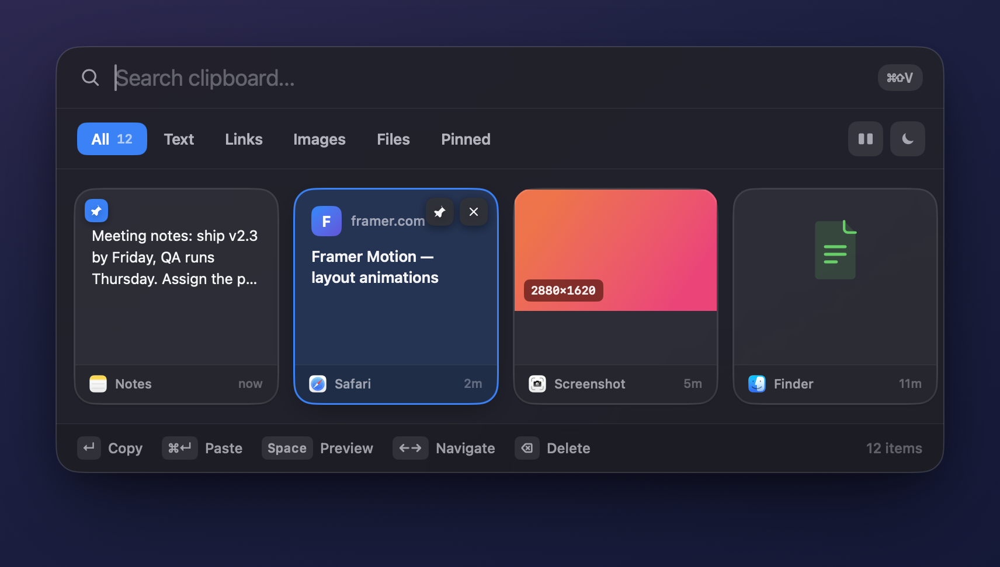
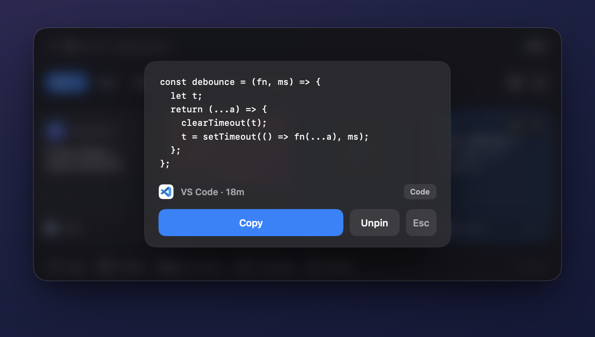
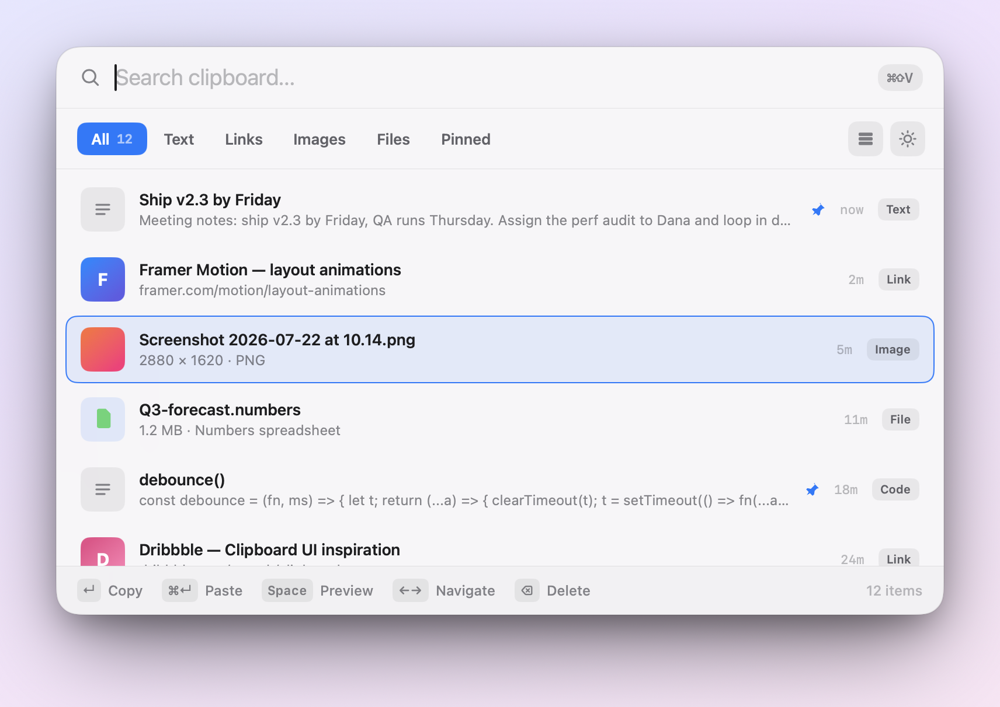

# Clipboard

A native macOS clipboard history manager. Press **⌘⇧V** anywhere to open a floating, translucent
panel with everything you've copied: text, code, links, images and files. Search it, filter it,
pin what matters, preview with Space, and paste straight back into the app you were using.



| Quick Look | Light, list layout |
|---|---|
|  |  |

Swift 6 (strict concurrency) · SwiftUI + AppKit · SwiftData · macOS 14 Sonoma or later · no web
views · one dependency: [KeyboardShortcuts](https://github.com/sindresorhus/KeyboardShortcuts).

## Features

- **Keyboard-first.** Everything works without the mouse; see [Keyboard](#keyboard).
- **Two layouts.** Horizontally scrolling cards, or a compact vertical list.
- **Search and filters.** Live, case- and accent-insensitive search over titles, contents, domains
  and source apps. Filters: All, Text, Links, Images, Files, Pinned.
- **Rich items.** Real image thumbnails, page titles and favicons for links, file and folder
  details, code shown in SF Mono, and the source app's icon.
- **Quick Look.** A preview of any item, with full text for long clips.
- **Paste-back.** ⌘↵ pastes into the previous app, with the right pasteboard types for each kind
  of item.
- **Private by design.** Passwords and other concealed items are never read, password managers are
  ignored, and everything stays on your Mac.
- **Pinning, dedupe, retention.** Pinned items never expire. Copying something again moves it to the
  top instead of adding a duplicate.
- **Light, dark or system appearance**, plus Reduce Motion, Reduce Transparency and VoiceOver
  support.

## Build and run

Requirements: Xcode 16 or later and [XcodeGen](https://github.com/yonaskolb/XcodeGen)
(`brew install xcodegen`).

```sh
xcodegen generate            # project.yml → Clipboard.xcodeproj (not checked in)
open Clipboard.xcodeproj     # or, from the command line:
xcodebuild -scheme Clipboard -derivedDataPath build/DerivedData build
```

The app lives in the menu bar (there's no Dock icon). The menu bar icon offers Open Clipboard, Pause
Capture, Clear History… (pinned items are kept), Settings… (also ⌘, in the panel) and Quit.

History is stored in `~/Library/Application Support/Clipboard/`: a SwiftData store plus `images/`
(originals), `thumbnails/` (352px wide) and `favicons/` (64px, one per host).

### Signing

A fresh clone builds with ad-hoc signing ("Sign to Run Locally"). Paste-back needs the Accessibility
permission, and macOS revokes it whenever an ad-hoc signed binary changes. To keep it across
rebuilds, give the build a stable identity in `Config/Local.xcconfig` (git-ignored). Either:

- run `./scripts/make-signing-cert.sh`, which creates a self-signed code-signing certificate in your
  login keychain and writes the config for you (no Apple Developer account needed), or
- copy `Config/Local.xcconfig.example` and set your `DEVELOPMENT_TEAM`.

Debug builds carry a `disable-library-validation` entitlement so the Hardened Runtime test host can
load the test bundle when signed without a Team ID. Release builds don't.

## Tests

```sh
./scripts/test.sh       # unit tests (Swift Testing + XCTest performance baselines)
./scripts/ui-test.sh    # UI tests (XCUITest, demo mode)
```

- **Unit tests** cover:
  - the classifier and code detection (including the edge cases);
  - privacy filtering;
  - capture end to end, against a private, uniquely named pasteboard, never yours;
  - dedupe, retention with pinned items, and image and favicon cleanup;
  - the write queue and optimistic updates;
  - search and filter combinations;
  - the full keyboard map, including non-Latin layouts and AZERTY;
  - scroll-into-view maths, relative time, paste-board writes, VoiceOver labels and preferences.
- **UI tests** open the panel in demo mode and drive arrow keys, Space and Esc, typing into search,
  ⌘1–⌘6 and filter clicks, and the layout toggle.

### Demo mode, benchmarks and debug scenarios

- **`--demo`** fills an in-memory store with the twelve sample items from the design. It never
  records or modifies your real history.
- **`--demo-count N`** pads the demo store to *N* items.
- **`--benchmark-open`** opens and closes the panel 30 times and prints the timings.
- **Preference overrides:** launch arguments such as `-layout list` and `-appearance light`
  override the stored preferences.
- **Debug-only scenarios** support screenshots and manual QA:
  - `--scenario preview|toast|empty|settings-general|settings-privacy|settings-about`
  - `--select N` and `--query TEXT`
  - `--backdrop` puts the design's wallpaper behind the panel. Every README screenshot uses it, so
    none show a real desktop.
  - `--reduce-transparency` renders the solid palette without changing system settings.

```sh
APP=build/DerivedData/Build/Products/Release/Clipboard.app/Contents/MacOS/Clipboard
$APP --demo --demo-count 1000 --benchmark-open
# open-benchmark items=1000 first=18.6ms median=11.6ms p95=13.7ms max=13.9ms
```

## Keyboard

| Key | Action |
|---|---|
| ⌘⇧V | Toggle the panel (global, configurable) |
| ↑ ↓ | Move the selection |
| ← → | Move the selection in the card layout, when the search is empty or unfocused |
| ↵ | Copy, then close |
| ⌘↵ | Paste into the previous app |
| Space | Toggle Quick Look (when the search isn't focused) |
| ⌫ / Delete | Delete the selected item (when the search isn't focused) |
| ⌘P | Pin or unpin |
| ⌘1…⌘6 | All, Text, Links, Images, Files, Pinned |
| Tab | Switch focus between search and results |
| ⌘, | Settings |
| Esc | Close the preview, then clear the search, then close the panel |

The search field has focus when the panel opens. Moving the selection hands focus to the results,
so Space and ⌫ act on the selection. Typing any character puts focus back in the search field and
adds the character there. The whole map is one pure function (`KeyRouter`), covered by unit tests.

## Capture and privacy

- **Polling.** The general pasteboard's `changeCount` is checked every 0.5s on a background actor,
  with timer tolerance so wake-ups can be coalesced. macOS has no change notification.
- **Classification priority.** Files and folders, then images (PNG, TIFF, JPEG), then a single
  http(s) URL, then text.
  - An image only wins over text when the copying app lists it first, so copying cells from Numbers
    or Excel (which attach a picture of the selection) stays text.
  - Text copied from editors and terminals, or with code-like syntax, is marked as code.
- **Privacy before reading.** These are rejected using the type list alone, so their contents are
  never read:
  - items marked `org.nspasteboard.ConcealedType`, `TransientType` or `AutoGeneratedType`;
  - copies from ignored apps: 1Password, Bitwarden, Keychain Access and Passwords by default,
    editable in Settings.

  An ignored app is matched by the `org.nspasteboard.source` marker, by the resolved source, and by
  any app that was frontmost since the last poll. So copying in Keychain Access and pressing ⌘Tab
  straight away is still skipped.
- **Dedupe.** Content is hashed (SHA-256 over kind and content). Copying something again moves the
  existing item to the top, before any image file is written.
- **Retention.** The newest *N* unpinned items are kept (default 500). Pinned items never expire and
  don't count towards *N*. Image and favicon files are deleted with the last item that uses them,
  and orphans are swept at launch.
- **Own writes** (copy and paste-back) are ignored by change count, and by source marker after a
  relaunch.
- **Link previews.** New links get their page title and favicon from LinkPresentation. Fetching a
  link is a network request on your behalf, so it can be turned off. Loopback, `.local`,
  single-label and private-network hosts are never fetched.

## Paste-back

↵ writes the item to the pasteboard, shows "Copied to clipboard" and closes the panel 0.6s later.
⌘↵ also closes the panel, returns focus to the app you were using and sends it ⌘V. A "Pasted →
*App*" toast appears where the panel was.

Items are written back in their native form: plain strings, URLs as both `public.url` and a string,
images as PNG or JPEG (plus TIFF, generated only if an app asks for it), and files as file URLs.
Files that no longer exist show an error instead of pasting nothing.

Sending ⌘V needs the **Accessibility** permission. The first time you press ⌘↵ without it,
Clipboard copies instead and opens a short explanation with a button to System Settings. That
window closes by itself once access is granted. The keystroke uses whichever key types "v" with ⌘
held in your current keyboard layout, so it works on Dvorak and AZERTY too.

## Settings

- **General:** hotkey recorder, launch at login (`SMAppService`), appearance, keep-pinned-on-top,
  history limit (100, 250, 500, 1,000 or unlimited) and Accessibility status.
- **Privacy:**
  - Ignore concealed items. This is on and locked; unlocking it asks for confirmation.
  - Link previews.
  - Ignored apps. Add them from running apps or pick one from Applications.
  - Clear History.
- **About:** version and credits.

## Architecture

```
Clipboard/
  App/        entry point, menu bar extra, composition root, global hotkey
  Panel/      FloatingPanel (non-activating NSPanel), PanelController, toast window, vibrancy
  Monitor/    PasteboardMonitor (actor), reader, privacy filter, classifier, code detector, processor
  Model/      ClipSnapshot, HistoryQuery, ClipItem (@Model), HistoryDatabase (model actor), HistoryStore
  Paste/      PasteService (typed writes, ⌘V via CGEvent), Accessibility permission and onboarding
  State/      PanelModel, KeyRouter, scroll-into-view maths
  Views/      SwiftUI views for every part of the panel
  Theme/      design tokens, typography, motion, SVG-ported glyphs, CSS-accurate shadows
  Settings/   Preferences, SettingsView, its window controller, launch at login
  Support/    caches (images, app icons), link metadata, thumbnails, paths, logging, demo, debug
```

- **Values only in views.** Views only ever see `ClipSnapshot`, an immutable `Sendable` value. Text
  is capped to a preview, and full payloads are loaded on demand. Search runs in memory over a
  pre-folded `searchKey`.
- **SwiftData stays in one actor.** It runs only inside `HistoryDatabase`, a model actor created off
  the main thread; on macOS 14, a `ModelContext` created on the main thread stays bound to it.
  - `HistoryStore` keeps the in-memory array the panel reads and sends every write through a FIFO
    queue.
  - Pin and delete are applied to that array immediately, and the database's view replaces it once
    the queue drains.
  - A store that can't be opened is moved aside rather than crashing the app.
- **The model is UI-agnostic.** `PanelModel` tracks the selection by item identity, so a reorder or a
  new capture never moves it to a different item. `PanelController` owns the AppKit side: window,
  focus, key monitor, copy and paste.
- **Nothing heavy on the main thread.** Pasteboard reads, classification, hashing, image encoding,
  thumbnailing, icon rendering and decoding all run on background actors or detached tasks.

## Performance

The panel window is created once and pre-rendered invisibly at launch, so opening it is a reposition
and a fade. Measured with `--benchmark-open` (Release build, 1,000 items, Apple silicon):

| | First open | Median | p95 |
|---|---|---|---|
| Cards | 19–30 ms | 11.6 ms | 14 ms |
| List | 14–18 ms | 11 ms | 13 ms |

The budget is 100 ms. Lazy stacks keep the cost flat: 5,000 items open in about 21 ms.

## Accessibility

- **VoiceOver.** Every card and row reads type, title, source, age and pin state, e.g. "Link,
  Framer Motion — layout animations, from Safari, 2 minutes ago, pinned".
  - Pin, delete and preview are available as actions.
  - Keyboard selection changes, filter switches and toasts are announced, because VoiceOver's cursor
    stays in the search field.
- **Reduce Motion.** No hover lift, panel scale, preview scale, toast slide or animated scrolling.
- **Reduce Transparency.** Solid panel, preview, toast and button colours, with no vibrancy or
  materials.

## Deviations from the design spec

Where SwiftUI or AppKit can't reproduce a CSS detail exactly:

- **Backdrop blur.** `blur(40px) saturate(180%)` is approximated with an `NSVisualEffectView`
  (`.popover` material, behind-window blending) under the spec's panel tint. AppKit doesn't let you
  set the blur radius or saturation.
- **Borderless window.** The panel is a borderless `NSPanel` rather than a titled window with a
  transparent titlebar, so the system frame doesn't draw its own corners, border or shadow over the
  design's.
- **Shadows.** CSS `box-shadow` values are reproduced with an outer-only shadow view (spread is
  emulated by insetting the shadow source). A SwiftUI shadow radius is treated as CSS blur ÷ 2.
- **Font weight 590.** This is built as an interpolated `NSFont` weight. SF Pro may snap it to the
  nearest weight its instances include.
- **Small blurs.** The blurred chips and the toast use SwiftUI materials under the token colour, so
  the blur radius is approximate. The Quick Look 18px backdrop blur is applied to the panel content
  itself (σ = 9pt).
- **Footer key chips.** Symbol-only keys (↵, ⌫, ←→) use SF Pro instead of SF Mono, because SF Mono
  has no ⌫ glyph and joins ←→ into a single ↔.
- **Dates.** Items older than a week show "12 Nov", with the year added for previous years.
- **File sizes.** Sizes use the system's localized format, which writes "340 kB" where the design
  shows "340 KB".
- **Paste keystroke.** ⌘V is sent with the key code that types "v" in the current layout rather
  than a fixed key code 9. On US layouts that is still 9.
- **Settings window.** Settings live in an `NSWindow` that hosts the SwiftUI view, not in SwiftUI's
  `Settings` scene. In a menu-bar-only app that scene opens behind other windows and can't be shown
  from AppKit code such as the panel's ⌘, shortcut.
- **Favicons.** A real favicon is drawn on a white rounded tile at the design's size. The gradient
  tile with the domain's initial is used until the favicon arrives, or if a site has none.
- **App icon.** The spec doesn't specify one. It's generated by `scripts/make-app-icon.swift` in the
  design's visual language.
- **Paste toast.** It names the target app ("Pasted → Notes") instead of the literal "frontmost app".
- **Empty states.** The design's "No matches" state is used for searches. An empty filter tab or an
  empty history gets its own wording, e.g. "No pinned items", instead of claiming the search failed.
- **Image files.** PNG and TIFF originals are saved as `.png`. JPEGs keep their original bytes as
  `.jpg`, because re-encoding them as PNG only makes them bigger. Images over 64 MB aren't recorded.

## License

MIT. See [LICENSE](LICENSE).
